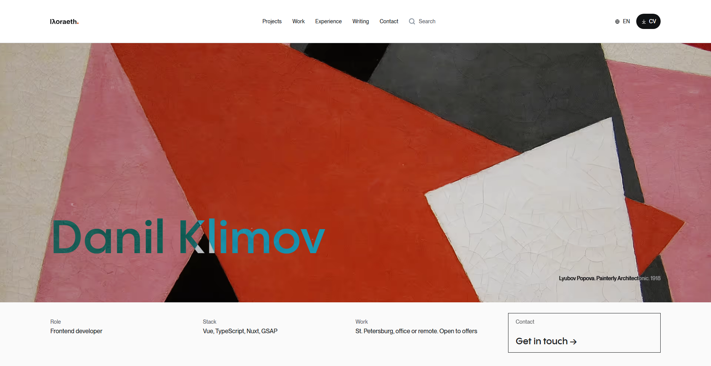
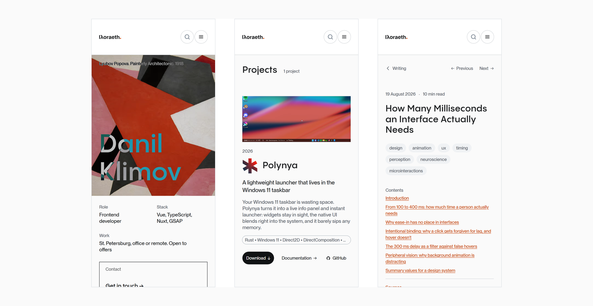
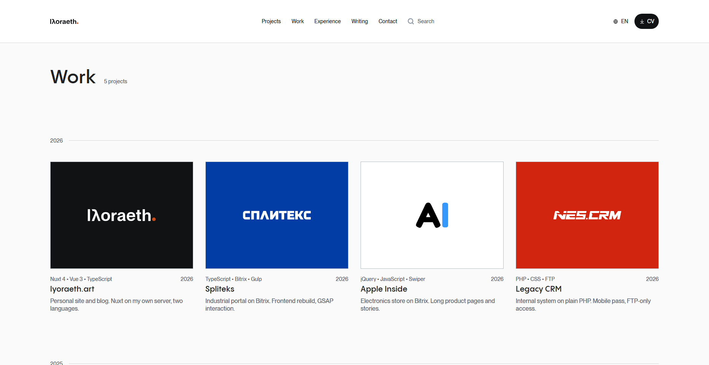
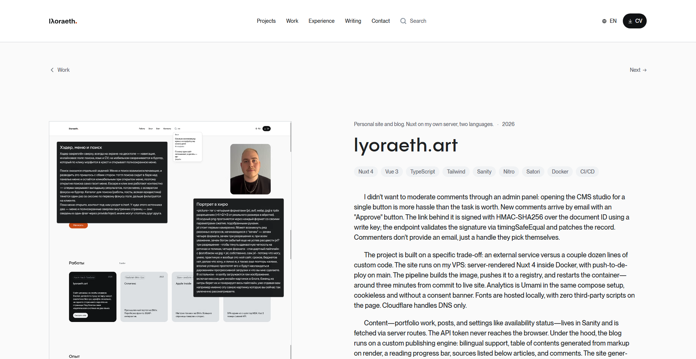
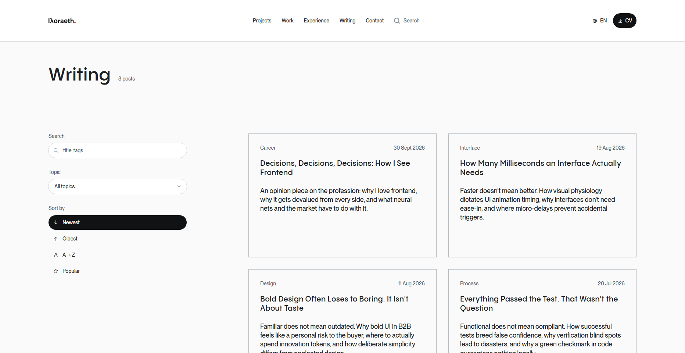
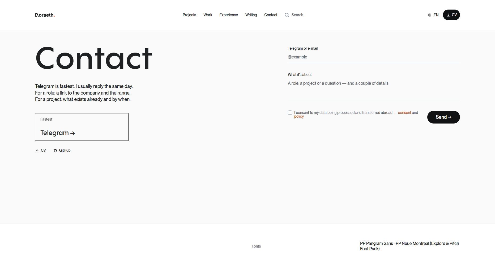

<div align="center">
  <h1>lyoraeth.art</h1>
  <p><b>Портфолио, документация open-source проектов и инженерный блог</b></p>
  <p>
    Nuxt 4 (SSR) · Sanity CMS · Свой медиапайплайн (JXL / AVIF) · Зеркало документации с GitHub · E2E на прод-образе
  </p>
  <p>
    <a href="README.md">English</a> · <b>Русский</b>
  </p>
  <p>
    <a href="https://lyoraeth.art"><b>lyoraeth.art</b></a> ·
    <a href="https://lyoraeth.art/projects">Проекты</a> ·
    <a href="https://lyoraeth.art/work">Работы</a> ·
    <a href="https://lyoraeth.art/writing">Блог</a> ·
    <a href="SECURITY.md">Безопасность</a>
  </p>
</div>

---

<p align="center">
  
  
</p>
<p align="center">
  
  
</p>
<p align="center">
  
  
</p>

**[lyoraeth.art](https://lyoraeth.art)** — мой сайт, портфолио коммерческих кейсов, хаб для собственных open-source проектов и блог про интерфейсы и разработку. Графикой, дизайном и программированием я занимаюсь параллельно еще с детства — и в коммерческих заказах, и в своих проектах они для меня всегда шли рука об руку. Поэтому мой главный интерес лежит на стыке визуала, кода и эстетики. По основному профилю я разрабатываю веб-приложения и дизайн-системы (**Vue / Nuxt, TypeScript, Tailwind CSS, Node.js**), но не ограничен только этим: берусь за веб-сервисы, десктопный софт, различные инструменты или игры — словом, за любую задачу, где четко вижу образ конечного продукта и понимаю, как довести его до релиза. А поскольку мне нравится (и часто просто приходится) собирать проекты целиком под ключ, всю сопутствующую серверную логику, пайплайны и инфраструктуру я тоже выстраиваю сам.

Это уже третья версия сайта. Предыдущие попытки (часть из них осталась в архивных репозиториях) уходили в крайности: либо в почти радикальный минимализм, либо в тяжелый оверинжиниринг. К слову об истории текущего сайта, когда его невзначай назвали «нейрослопом», я зарылся в доведение и вывел собственный визуальный язык, который с тех пор постоянно шлифую, как и техническую сторону сайта: по мере роста навыков планка допустимого все время ползет вверх.

Сейчас здесь одна светлая тема, 12-колоночная сетка с разделителями в 1px, система дизайн-токенов и SSR-first архитектура на **Nuxt 4**. Сайт двуязычный (`/` — EN, `/ru/` — RU), работает без сторонних трекеров, внешних шрифтов и чужих CDN для доставки картинок. Весь контент управляется через Sanity, но запрашивается и обрабатывается строго на сервере: браузер получает готовый HTML, локально нарезанную графику (`JXL / AVIF / WebP / JPG`) и шрифты со своего домена.

Проект живет на одном VPS в Docker-контейнере рядом с собственной инстанцией аналитики Umami. Каждый пуш в `main` собирает образ, прогоняет на нем unit- и e2e-тесты и выкатывает обновление с автоматическим откатом, если прод не прошел `healthcheck`.

---

## Стек и инфраструктура

| Часть системы | Чем решено | Зачем и как используется |
| :--- | :--- | :--- |
| **Фреймворк** | Nuxt 4, Vue 3 (Composition API), Nitro | SSR-first, файловый роутинг, серверные API-роуты и фоновые задачи в одном процессе |
| **Стили** | Tailwind CSS v4 (`@theme static`) | Дизайн-токены генерируются как глобальные CSS-переменные, чтобы к ним можно было обращаться напрямую из `scoped`-стилей компонентов |
| **CMS** | Sanity (`studio/` в репо) | Работы, проекты, посты, комментарии, оценки и глобальные настройки; запросы через GROQ только с сервера |
| **Локализация** | `@nuxtjs/i18n` (`prefix_except_default`) | Определение языка браузера при первом визите, хранение в cookie `i18n_locale` |
| **Markdown, схемы и код** | `marked`, `Mermaid`, `Shiki` | Кастомный рендерер для статей, проектов и юр. страниц; динамический импорт диаграмм Mermaid; ленивая подсветка кода в доках |
| **Медиапайплайн** | `ffmpeg`, `cjxl`, `webpmux` | Фоновая нарезка оригиналов из Sanity в JXL / AVIF / WebP / JPG *(JXL — просто потому что могу)* и вычленение первого кадра анимаций |
| **OG-карточки** | `satori` + `resvg` | Серверный рендер превью для страниц без обложки, без внешних микросервисов |
| **Почта и защита** | Resend SDK + Cloudflare Turnstile | Контакты, модерация комментариев из письма и алерты CSP без своего SMTP-сервера |
| **Аналитика** | Umami (self-hosted + Postgres) | Свой контейнер в `docker-compose.yml`, без cookies и передачи данных третьим лицам |
| **Сборка и тесты** | Docker (`node:22-alpine`), Vitest, Playwright | Multi-stage сборка, GHCR, 189 unit-тестов и 45 e2e-тестов против собранного прод-образа |
| **Хостинг и сеть** | VPS Sprinthost (СПб), nginx-proxy-manager | SSL, rate-limit и редиректы на уровне nginx; DNS в Cloudflare в режиме DNS-only (без прокси, чтобы сайт открывался в РФ без VPN) |

---

## Что внутри и как это устроено

### 1. Свой медиапайплайн вместо CDN Sanity
Картинки загружаются в Sanity в оригинале, но встроенные CDN-трансформы CMS для отдачи не используются: у Sanity нет JXL, нестабильный AVIF и заметное мыло на высоком качестве сжатия.

* **Фоновая кодировка с бюджетом:** планировщик Nitro запускает задачу `media:sync` каждые 5 минут внутри контейнера приложения. За один прогон кодируется не более 12 вариантов (`mediaSyncBatch`) — если загрузить пачку новых кейсов, очередь растянется на несколько тиков и не положит CPU на VPS. Неиспользуемые варианты удаляются (с предохранителем от очистки при пустом ответе Sanity).
* **Форматы и ручная калибровка:** порядок в `<picture>` — `jxl → avif → webp → jpg`. По весу файла JXL (`cjxl -d 1.8 -e 7 -p`) проигрывает AVIF, но мне банально очень нравится сам формат и его прогрессивная загрузка — хотелось применить его на практике и немного выпендриться. AVIF кодируется через `libaom-av1` в полной цветности `yuv444p` (`crf 23`), так как мелкий текст и плоские цвета интерфейсов на скриншотах портфолио плохо переносят стандартный субсэмплинг. WebP идет с пресетом `text` и ограничением длинной стороны в 16383px (лимит формата для длинных «простыней»).
* **Два семейства нарезки:** `full` сохраняет пропорции оригинала (лестница `640 / 1280 / 1920 / 2560` с обрезкой по ширине исходника), а `cover` режет кадр на сервере в `4:3` с якорем по верхнему краю (`480 / 960 / 1440 / 1920`), чтобы узкая карточка не тянула полноразмерный скриншот страницы.
* **Фолбэк на лету:** тег `<picture>` по спецификации не откатывается на следующий `<source>`, если выбранный вариант вернул 404 (например, еще стоит в очереди на кодирование). Поэтому при ошибке загрузки `` клиентский скрипт сбрасывает теги `<source>`, и картинка подтягивается напрямую с сырого URL Sanity.
* **Анимированные WebP и GIF:** определяются по заголовкам файла без полного декодирования (флаг в чанке `VP8X` у WebP или число кадров > 1 у GIF). Оригинал сохраняется как `{sha1}-anim.{webp|gif}`, а первый кадр вырезается через `webpmux` и прогоняется через обычный пайплайн как статичная заглушка. Клиент сначала рендерит заглушку, в фоне грузит анимацию и подменяет кадр после `decode()` (при `prefers-reduced-motion` или в обрезке `4:3` остается статика).

### 2. Зеркало документации с GitHub (`/projects/[slug]/docs`)
У каждого open-source проекта на сайте есть свой лендинг и опциональный раздел документации. Тексты забираются напрямую из репозитория проекта на GitHub:

* **Дерево и локали:** структура строится по `docs/SUMMARY.md` (формат mdBook) и `docs/ru/SUMMARY.md`. Русские и английские страницы сопоставляются по позиции в дереве, а при расхождении структуры срабатывает откат на английскую версию.
* **Изоляция и безопасность:** так как документация рендерится через `v-html`, владелец репозитория жестко ограничен белым списком (`lyoraeth`) и в схеме Studio, и на сервере. Попытки выхода за пределы папки (`../`) резолвятся в `null`, а из внешних схем ссылок пропускаются только `http(s)` и `mailto`. Внутренние ссылки автоматически переписываются на роуты сайта или лендинг проекта.
* **Дисковый кеш и отказоустойчивость:** индекс и страницы кешируются на диске в томе медиафайлов (`media/_docs-cache`, 30 минут актуальности + сутки stale) и переживают рестарт контейнера. Таймаут запроса к GitHub — 8 секунд, ответы тяжелее 512 КБ отбрасываются. Если GitHub не ответил, ресурс заносится в память сбоев (до 500 ключей) и в течение минуты отдает быстрый отказ без ожидания таймаута; при пустом кеше рендерится страница «документация временно недоступна» со ссылкой на репо.
* **Поиск и подсветка:** клиентский поиск индексирует заголовки страниц обеих локалей и подзаголовки `h2`/`h3` текущего языка. Грамматики Shiki подгружаются лениво после монтирования только для тех языков, которые встретились на странице.

### 3. Контент, CMS и модерация без админки
* **Двуязычие внутри документа:** в Sanity обе локали хранятся в полях `{ en, ru }` одного документа. Сервер отдает оба языка сразу, переключение на клиенте происходит мгновенно через `useLoc`.
* **Расширенный Markdown:** в статьях поддерживаются галереи по ключу (`{ar=16/9 fit=cover pos=top}` — неизвестный ключ безопасно превращается в пустой HTML-комментарий), нумерованные списки источников и диаграммы `mermaid` (сам пакет импортируется динамически только в тех постах, где есть соответствующий блок кода).
* **Модерация комментариев в один клик из почты:** новые комментарии проходят проверку Turnstile и сохраняются в Sanity с `approved: false`. Сервер через Resend отправляет мне письмо с текстом и ссылкой `GET /api/comment/approve?id=…&token=…`. Токен — это `HMAC-SHA256` от ID документа, проверяемый через `timingSafeEqual`. Одобрить комментарий можно прямо с телефона без входа в Sanity Studio.
* **Оценки без хранения IP:** голосование за статьи (`POST /api/rating/[slug]`) дедуплицирует голоса, используя в качестве ID документа соленый `SHA-256` от связки `IP + slug`. Сырые IP-адреса нигде не сохраняются.
* **Плашка техработ:** синглтон `siteSettings` в CMS позволяет без деплоя включить верхний баннер уведомлений. Через селектор `html:has(.site-notice)` выставляется переменная `--notice-h`, на которую автоматически сдвигаются липкая шапка и `scroll-padding-top` якорных ссылок.

### 4. Дизайн-система, типографика и движение
* **Сетка и токены:** 12 → 8 → 4 колонки (шаг `sm` на 640px отключен намеренно, максимальная полоса контента — `1680px` / `105rem`). Все цвета заданы в `oklch` в файле `design-system.css` с автоматическим hex-фолбэком через блок `@supports not (color: oklch(0 0 0))`.
* **Три геометрических правила форм:** весь контент (карточки, изображения) — прямоугольный без скруглений; элементы управления и фильтры (кнопки «Все…», теги, ссылки на CV) — круглые пилюли; два главных акцентных действия (кнопка «Написать» в хиро и Telegram в контактах) — прямоугольные ячейки с подписью сверху и заливкой при наведении.
* **Лицензионные шрифты вне репозитория:** используются **PP Neue Montreal** (текст, UI) и **PP Pangram Sans** (заголовки). Файлы `.woff2` не лежат в Git и не запекаются в Docker-образ: они монтируются с хоста в `/app/fonts` и отдаются серверным роутом Nitro `/fonts/[file]` с проверкой имени по регулярке, вечным кешем и заголовком `Cross-Origin-Resource-Policy: same-origin` против хотлинка с чужих доменов.
* **Калибровка анимаций и скролл:** длительности переходов выбраны по ограничениям зрительного восприятия (разбор опубликован в посте *«How Many Milliseconds an Interface Actually Needs»*): базовый ховер — `180 мс`, нажатие — `90 мс`, реакция соседних элементов карточки — `220 мс`, волна заливки карточки блога — `620 мс`. Используется единая кривая `--ease-out` и ее точное отражение `--ease-in` для уходящих с экрана элементов. Один блок `prefers-reduced-motion` мгновенно гасит все переходы. Кастомный перехватчик скролла (Lenis) полностью удален — в первой версии сайта он ломал прокрутку на телефонах Xiaomi и тачпадах ASUS; теперь скролл нативный браузерный.
* **Карточки без перекрывающих ссылок:** карточки кликабельны целиком без натянутого поверх пустого `<a>`. Настоящая ссылка стоит только на заголовке, а карточка программно пересылает жесты: текст внутри можно спокойно выделять мышью, клик по тексту ждет окно двойного клика, а `Ctrl` / `⌘` / колесико мыши открывают вкладку в фоне. Ховеры закрыты за `@media (hover: hover)` и не залипают при тапе с телефона.

### 5. SEO, ИИ-агенты и генерация статики
* **Связанный граф JSON-LD:** на главной странице объявляется узел `Person` с `@id`, а схемы `BlogPosting`, `CreativeWork` и `SoftwareSourceCode` на внутренних страницах ссылаются на него по идентификатору.
* **Динамические OG-превью:** если у страницы нет своей обложки, роут `/og/[type]/[slug]` на лету собирает карточку через `satori` и `resvg`. В кеш Nitro сохраняется `base64`-строка, так как встроенный кеш сериализует записи в JSON и при сохранении сырого `Buffer` превращал его в объект `{"type":"Buffer",...}`, из-за чего превью в Telegram висели на загрузке.
* **Машиночитаемость (`llms-full.txt` и WebMCP):** помимо `sitemap.xml` и локализованных RSS-лент (закрытых в `noindex`, чтобы поисковики не считали EN и RU фиды дублями), роут `/llms-full.txt` собирает из Sanity все работы и статьи в единый текстовый документ для LLM. На странице также регистрируется инструмент WebMCP `send_message`, позволяющий ИИ-агентам отправлять форму контактов напрямую без парсинга верстки (защищен лимитом длины и rate-limit).

### 6. Безопасность и приватность
* **Заголовки:** все ответы отдаются с `Strict-Transport-Security` (preload), `Cross-Origin-Opener-Policy: same-origin`, `X-Frame-Options: DENY` и жестким `Permissions-Policy` (отключены камера, микрофон, геолокация, платежи, USB, Bluetooth и FLoC).
* **Собственный приемник CSP:** политика `Content-Security-Policy-Report-Only` отправляет отчеты о нарушениях на внутренний эндпоинт `POST /api/csp-report`, который пересылает их письмом через Resend без сторонних коллекторов (в dev-режиме отправка отключена, чтобы не спамить на срабатывания HMR и Vue DevTools).
* **Защита эндпоинтов:** `POST /api/comment`, `/api/contact` и `/api/mcp/send` прикрыты от флуда на уровне nginx (`limit_req_zone`) и отсекают лишние запросы кодом `429` до попадания в Node.js. Настроены PGP-подписанный `/.well-known/security.txt` и политика раскрытия уязвимостей в [SECURITY.md](SECURITY.md).

---

## CI/CD и тестирование

Пайплайн деплоя (`.github/workflows/deploy.yml`) выстроен так, чтобы нерабочий образ не мог остаться на продакшене. Параллельные запуски ставятся в очередь (`concurrency: deploy` без отмены текущего шага), чтобы избежать `race condition` при деплое двух коммитов подряд по SSH.

1. **Verify:** быстрая проверка без браузера и Docker — `pnpm install --frozen-lockfile`, ESLint, проверка типов и **189 unit-тестов (Vitest)** (композаблы, парсеры Markdown и документации, лестница ширин медиа, паритет ключей локализации `en.json` / `ru.json`, генератор версий).
2. **Build image:** сборка multi-stage образа и пуш в GHCR под тегом коммита (не `latest`). На этом же шаге скрипт `computeVersion.mjs` проигрывает всю историю Git и вычисляет семантическую версию вида `2.x.y+build` для колофона в футере.
3. **E2E against the built image:** в CI поднимается ровно тот Docker-контейнер, который поедет на сервер (с тестовыми ключами Turnstile и заглушками шрифтов). После прохождения `HEALTHCHECK` по нему прогоняются **45 e2e-тестов (Playwright)**: проверяется навигация без ошибок гидрации и потери корневого узла (`<Transition>`), лайтбокс, медиапайплайн, отсутствие ошибок в консоли, горизонтального скролла, утечек слушателей событий, а также бюджеты производительности (LCP < 2.5 с, рост heap при скролле < 100 МБ).
4. **Promote to latest:** только после зеленого Playwright образ получает тег `latest`.
5. **Deploy & Auto-rollback:** деплой по SSH записывает новую версию напрямую в `.env`, запоминает ID текущего рабочего образа, обновляет контейнер и ждет статуса `healthy` внутри Docker + успешного внешнего smoke-запроса к `https://lyoraeth.art`. Если любая из проверок падает, скрипт **автоматически откатывает** тег `latest` и `.env` на предыдущую версию и перезапускает старый контейнер.

> **Деталь про IPv6 в Alpine:** `HEALTHCHECK` внутри контейнера бьет строго в `http://127.0.0.1:3000/api/health`, а не в `localhost`. В `node:22-alpine` имя `localhost` резолвится в том числе в `::1`, и встроенный в busybox `wget` пытается сначала стучаться по IPv6, где Node (`HOST=0.0.0.0`) не слушает.

---

## Известные ограничения и планы

Текущие компромиссы архитектуры и задачи в очереди:

* **CSP в режиме Report-Only:** политика безопасности контента пока собирает статистику по белому списку перед переключением в блокирующий режим (Enforce).
* **Очередь проверки анимаций:** проверка существующих WebP/GIF на наличие анимации в задаче `media:sync` сейчас делит общий лимит прогона (`mediaSyncBatch = 12`) с кодированием новых картинок и ждет свободного окна.
* **Лимиты документации из GitHub:** запросы к GitHub API за последним релизом идут без токена (лимит 60 запросов в час с IP сервера, сглаживается 30-минутным кешем), а ветка документации пока прибита к `main` (поддержка тегов `docsRef`, пагинация prev/next и полнотекстовый поиск отложены).
* **Метрики производительности:** бюджеты LCP и памяти проверяются синтетически в Playwright на каждом билде (локальный LCP ~572 мс), но сбор RUM / CrUX и Lighthouse CI еще не подключены.

---

## Локальный запуск и разработка

**Требования:** Node.js 22+, `pnpm`, а также установленные в `PATH` утилиты `ffmpeg`, `cjxl` (`libjxl-tools`) и `webpmux` (`libwebp-tools`) для штатной работы медиапайплайна (если их нет в системе, задача кодирования не запустится, но сам сайт продолжит работать в режиме аварийного фолбэка, отдавая сырые исходники с CDN Sanity).

1. Установите зависимости и скопируйте шаблон переменных окружения:
   ```bash
   pnpm install
   cp .env.example .env
   ```
2. Заполните в `.env` ключи проекта Sanity (`NUXT_SANITY_PROJECT_ID`, `DATASET`, `TOKEN`), тестовые или боевые ключи Turnstile и API-ключ Resend.
3. Запустите сервер разработки:
   ```bash
   pnpm dev          # http://localhost:3000
   ```

### Полезные команды

```bash
# Сборка и локальный предпросмотр продакшен-версии
pnpm build && pnpm preview

# Проверка линтером и проверка типов TypeScript
pnpm lint
pnpm typecheck

# Запуск unit-тестов (Vitest)
pnpm test

# Запуск e2e-тестов (Playwright сам поднимет сервер, если он не запущен)
pnpm test:e2e

# Деплой схем и интерфейса Sanity Studio (требуются права владельца проекта)
cd studio && npx sanity deploy
```

---

## Структура репозитория

```text
app/
  components/           # SiteHeader, MobileMenu, PageFooter, SiteNotice, SanityPicture,
                        # WorkCard, PostCard, ProjectShowcase, DocsSidebar, ArticleToc,
                        # SearchResults, LegalArticle, sections/*, post/*
  composables/          # useMarkdown, useToc, useSiteSearch, useDocsSearch, useCodeHighlight,
                        # useAnimatedMedia, useArticleSeo, useCardLink, useTrack, useReveal...
  pages/                # index, projects/[slug](/docs/[[page]]), work/[slug], writing/[slug],
                        # privacy, personal-data (152-ФЗ)
  layouts/redesign.vue  # Основная оболочка сайта
  assets/css/           # main.css (слои), design-system.css (токены), prose.css (типографика статей)
  assets/content/       # Юридические тексты в Markdown (EN / RU)
shared/
  media.ts              # Правила именования и лестница ширин (общие для сервера и клиента)
  docs.ts, markdown.ts  # Общие утилиты парсинга и навигации
server/
  api/                  # Эндпоинты контента, контактов, комментариев, оценок, релизов, CSP и WebMCP
  routes/               # Раздача /media/*, /fonts/*, генерация /og/*, sitemap.xml, rss.xml, llms-full.txt
  tasks/media/sync.ts   # Планировщик кодирования изображений (раз в 5 минут)
  utils/                # Клиенты Sanity и GitHub, кодировщик медиа, кеш сбоев, шаблоны OG
  plugins/timing.ts     # Заголовок Server-Timing: app;dur=
studio/                 # Sanity Studio (схемы документов и конфигурация)
scripts/                # computeVersion.mjs (расчет semver-версии из истории коммитов)
tests/                  # unit/ (Vitest) и e2e/ (Playwright)
i18n/locales/           # Словари интерфейса en.json и ru.json
```

---

## Как это сделано

Этот сайт — концентрат тех практических навыков, архитектурных паттернов и приемов верстки, которые я изучил и обкатал вживую на основной работе и фрилансе. Весь визуальный дизайн, сетка, типографика и система токенов спроектированы мной.

При разработке использовался подход [agentic engineering](https://simonwillison.net/2026/may/6/vibe-coding-and-agentic-engineering) в паре с [Claude Code](https://claude.com/claude-code) (Anthropic), но в отличие от моих экспериментов с rust, роль ИИ здесь утилитарная. Поскольку веб-стек для меня профильный, архитектуру, структуру компонентов, серверную логику и инфраструктуру я придумывал и частично писал сам по уже знакомым мне рабочим паттернам.

Каждое решение проверено руками и покрыто автотестами на реальном прод-образе, но я всегда рад конструктивному взгляду со стороны. Если заметите баг, архитектурный просчет или место в коде, которое можно сделать чище — напишите мне в Telegram или откройте [issue](https://github.com/lyoraeth/lyoraeth-art/issues).

---

## Контакты и атрибуция

По вопросам работы, сотрудничества или обсуждения кода:

* **Сайт и форма связи:** [lyoraeth.art/#contact](https://lyoraeth.art/#contact)
* **Telegram:** [@lyoraeth](https://t.me/lyoraeth)
* **GitHub:** [@lyoraeth](https://github.com/lyoraeth)

### Атрибуция
* **Шрифты:** PP Neue Montreal и PP Pangram Sans от [Pangram Pangram](https://pangrampangram.com/) (Explore & Pitch Font Pack).
* **Изображение в хиро:** Л. С. Попова, *«Живописная архитектоника»*, 1918 г. (общественное достояние, коллекция MoMA / Wikimedia Commons).

---

## Лицензия

Проект опубликован под **Source Reference License**. Исходный код открыт исключительно для ознакомления и изучения инженерных решений. Копирование кода, дизайна, графики, текстов, словарей локализации и юридических документов запрещено. Полные условия — в файле **[LICENSE](LICENSE)**.
